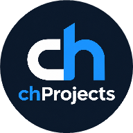

  

# chProjects

Site da **chProjects** (Carlos Henrique Projetos), onde reúno os apps e jogos que desenvolvo.

Alguns dos projetos que estão lá:

- **Terra Marcada**: app de campo e CAD rural para topografia e georreferenciamento ([Google Play](https://play.google.com/store/apps/details?id=com.chprojects.terramarcada))
- **Legacy: Ano 25**: jogo de sobrevivência multiplayer para PC e Android ([site do jogo](https://legacy.ruralplanpb.com/))
- **Projeto Mutante**: jogo de ação cooperativo para celular ([Google Play](https://play.google.com/store/apps/details?id=com.chprojects.com.projetomutante))

## Contato

- E-mail: carloshenriquebr92@gmail.com
- WhatsApp: (61) 99947-8329

---

Site estático em HTML, CSS e JavaScript, publicado pelo GitHub Pages.
